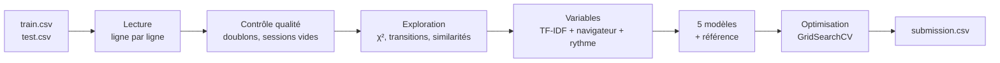

<div align="center">


# Qui utilise mon appli ?
### Identification des utilisateurs du logiciel Copilote à partir de leurs traces d'utilisation

**MOD 7.2 . Introduction à la science des données . BE séances 1, 2, 3**
<br/>
École Centrale de Lyon . Année 2026/2027 . Groupe TD 4

<br/>


</div>

---

## Équipe

- **Hajar Zarguan**
- **Valentine Ponce**
- **Guillaume Sumian**

**Enseignants :** Julien Velcin (CM, BE), Antoine Becquet (BE)

---

## Le problème

La société **Infologic** édite le logiciel **Copilote**, utilisé dans l'agroalimentaire. Ses testeurs internes
utilisent plusieurs profils pour tester le logiciel ; retrouver **qui** se cache derrière une session simplifierait
leur travail et permettrait aussi de **détecter une usurpation de compte**.

Chaque ligne des fichiers est une **session** :

```
sph,Firefox,Exécution d'un bouton(fr.infologic...CopiloteWebSharedController)<DEFAUT>$AC$,t5,Exécution d'un bouton,t10
```

| Élément | Signification |
| --- | --- |
| `sph` | utilisateur (trigramme), uniquement dans `train.csv` |
| `Firefox` | navigateur |
| `Nom(écran)` | action et écran sur lequel elle a lieu |
| `<config>` | configuration d'écran |
| `$chaîne$` | chaîne de la fiche (regroupement logique) |
| `...1` | l'utilisateur est en modification dans la fiche |
| `t5`, `t10`, ... | fenêtres temporelles de 5 secondes |

**Objectif :** prédire l'utilisateur de chaque session de `test.csv` (classification multi-classe, 247 utilisateurs).
**Évaluation :** F1 score sur le leaderboard Kaggle du groupe 4.

---

## Organisation du dépôt

```
BE_DataSciences/
├── Data/                     # train.csv, test.csv, sample_submission.csv (non versionnés)
├── src/
│   └── analyse_donnees.py    # toutes les fonctions, rangées en 5 sections
├── prepare_data.ipynb        # notebook principal : de la lecture à la soumission
├── requirements.txt
└── README.md
```

`src/analyse_donnees.py` est organisé dans le même ordre que le notebook :

| Section | Contenu | Fonctions principales |
| :---: | --- | --- |
| **1** | Configuration | `configurer_graphiques`, `trouver` |
| **2** | Préparation et nettoyage | `read_ds`, `construire_table_sessions`, `decrire_session`, `controler_qualite`, `nettoyer_sessions`, `retirer_sessions_aberrantes` |
| **3** | Visualisation | `browsers_analysis`, `actions_analysis`, `analyser_composants_logiciels`, `tracer_comparaison_modeles`, `tracer_matrice_confusion`, `tracer_importance_variables` |
| **4** | Modèles | `construire_preparation`, `creer_modeles`, `decouper_apprentissage_validation`, `comparer_modeles`, `validation_croisee` |
| **5** | Optimisation et soumission | `optimiser_tous_les_modeles`, `optimiser_modele`, `entrainer_modele_final`, `ecrire_soumission` |

---

## Démarche



### 1. Préparation et nettoyage
- Lecture **ligne par ligne** : les sessions vont de quelques actions à plusieurs milliers, un `read_csv` classique ne suffit pas.
- Découpage de chaque jeton en **type d'action, écran, configuration, chaîne, modification**.
- Contrôle qualité : lignes vides, sessions sans action, jetons mal formés, **doublons** (retirés de `train.csv`).
- Les sessions très longues ne sont pas supprimées (ce sont de vraies sessions) : durée et nombre d'actions passés au **logarithme**.

### 2. Exploration
- Classes **déséquilibrées** : de 4 à 75 sessions par utilisateur (médiane 12).
- **Un utilisateur = un seul navigateur** : variable très discriminante.
- **Test du χ²** : les types d'action, écrans, configurations et chaînes les plus liés à l'utilisateur.
- **Matrice de transition** entre actions et **similarité cosinus** entre profils d'utilisateurs.

### 3. Variables
| Groupe | Construction |
| --- | --- |
| `actions` | TF-IDF des jetons complets (type + écran + configuration + chaîne) |
| `enchainements` | TF-IDF des n-grammes (1 à 3) de types d'action |
| `composants` | TF-IDF des écrans, configurations et chaînes |
| `navigateur` | one-hot |
| `statistiques` | log(nb actions), log(durée), cadence, nb de types, entropie, nb d'écrans (centrées réduites) |

### 4. Modèles comparés
Référence (classe majoritaire), **régression logistique**, **SVM linéaire**, **perceptron multicouche (MLP)**,
**arbre de décision**, **forêt aléatoire**. Découpage **stratifié** 75 % / 25 %, préparation incluse dans un
`Pipeline` pour ne jamais apprendre sur la validation.

### 5. Optimisation
`GridSearchCV` (validation croisée stratifiée à 3 plis, sur la partie apprentissage uniquement) : régularisation `C`,
pondération des classes, architecture du MLP, profondeur des arbres, nombre d'arbres. Puis réglage de la préparation
(`min_df`, longueur des n-grammes) sur le meilleur modèle, et réentraînement sur tout `train.csv`.

---

## Résultats

| Modèle | F1 validation (initial) | F1 validation (optimisé) |
| --- | :---: | :---: |
| Référence | — | — |
| Régression logistique | — | — |
| SVM linéaire | — | — |
| Perceptron multicouche | — | — |
| Arbre de décision | — | — |
| Forêt aléatoire | — | — |

> Les valeurs sont produites par les sections 3.3 et 4.2 du notebook.
> **Score Kaggle (leaderboard public) :** —

---

## Installation et exécution

```bash
git clone https://github.com/valponce/BE_DataSciences.git
cd BE_DataSciences
python -m venv .venv
source .venv/bin/activate        # Windows : .venv\Scripts\activate
pip install -r requirements.txt
```

1. Télécharger `train.csv`, `test.csv` et `sample_submission.csv` depuis la page Kaggle du challenge et les placer dans `Data/`.
2. Ouvrir `prepare_data.ipynb` **depuis la racine du dépôt** et exécuter toutes les cellules.
3. Le fichier `submission.csv` est créé à la racine : il se dépose sur Kaggle et sur Moodle.

> L'optimisation (section 4.2) teste plusieurs dizaines de combinaisons de paramètres : compter quelques minutes à
> quelques dizaines de minutes selon la machine.

---

<div align="center">

<sub>École Centrale de Lyon . MOD 7.2 Introduction à la science des données . 2026/2027</sub>

</div>
