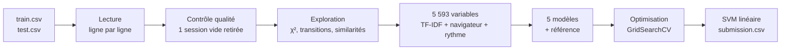

<div align="center">


# Qui utilise mon appli ?
### Identification des utilisateurs du logiciel Copilote à partir de leurs traces d'utilisation

**MOD 7.2 . Introduction à la science des données . BE séances 1, 2, 3**
<br/>
École Centrale de Lyon . Année 2026/2027 . Groupe TD 4

<br/>


</div>

---

## En bref

> À partir de la seule trace de ses actions dans Copilote, notre modèle retrouve l'utilisateur de **95,7 %** des
> sessions de validation, parmi **247 personnes**. Le meilleur modèle est un **SVM linéaire** appliqué à une
> représentation **TF-IDF** des actions, de leurs enchaînements et des écrans utilisés, complétée par le navigateur
> et le rythme de travail.

---

## Équipe

- **Hajar Zarguan**
- **Valentine Ponce**
- **Guillaume Sumian**

**Enseignants :** Julien Velcin (CM, BE), Antoine Becquet (BE)

---

## Le problème

La société **Infologic** édite le logiciel **Copilote**, utilisé dans l'agroalimentaire. Ses testeurs internes
utilisent plusieurs profils pour tester le logiciel ; retrouver **qui** se cache derrière une session simplifierait
leur travail et permettrait aussi de **détecter une usurpation de compte**.

Chaque ligne des fichiers est une **session** :

```
sph,Firefox,Exécution d'un bouton(fr.infologic...CopiloteWebSharedController)<DEFAUT>$AC$,t5,Exécution d'un bouton,t10
```

| Élément | Signification |
| --- | --- |
| `sph` | utilisateur (trigramme), uniquement dans `train.csv` |
| `Firefox` | navigateur |
| `Nom(écran)` | action et écran sur lequel elle a lieu |
| `<config>` | configuration d'écran |
| `$chaîne$` | chaîne de la fiche (regroupement logique) |
| `...1` | l'utilisateur est en modification dans la fiche |
| `t5`, `t10`, ... | fenêtres temporelles de 5 secondes |

**Objectif :** prédire l'utilisateur de chacune des 324 sessions de `test.csv` (classification multi-classe,
247 utilisateurs). **Évaluation :** F1 score sur le leaderboard Kaggle du groupe 4.

---

## Organisation du dépôt

```
BE_DataSciences/
├── Data/                     # train.csv, test.csv, sample_submission.csv (non versionnés)
├── src/
│   ├── analyse_donnees.py    # point d'entrée : regroupe les 5 fichiers ci-dessous
│   ├── configuration.py      # 1. constantes, style des graphiques, recherche des données
│   ├── preparation.py        # 2. lecture, nettoyage, variables de chaque session
│   ├── visualisation.py      # 3. graphiques de l'exploration et de l'analyse des modèles
│   ├── modeles.py            # 4. préparation des variables, modèles, évaluation
│   └── optimisation.py       # 5. recherche sur grille, modèle final, soumission
├── prepare_data.ipynb        # notebook principal : de la lecture à la soumission, commenté
├── requirements.txt
└── README.md
```

Le code est réparti en un fichier par étape. Le notebook n'a qu'un seul import à faire,
`import analyse_donnees as AN`, qui donne accès à toutes les fonctions :

| Fichier | Étape | Fonctions principales |
| --- | --- | --- |
| `configuration.py` | Configuration | `configurer_graphiques`, `trouver` |
| `preparation.py` | Préparation et nettoyage | `read_ds`, `construire_table_sessions`, `decrire_session`, `controler_qualite`, `nettoyer_sessions`, `retirer_sessions_aberrantes` |
| `visualisation.py` | Visualisation | `browsers_analysis`, `actions_analysis`, `analyser_composants_logiciels`, `tracer_comparaison_modeles`, `tracer_matrice_confusion`, `tracer_importance_variables` |
| `modeles.py` | Modèles | `construire_preparation`, `creer_modeles`, `creer_pipeline`, `decouper_apprentissage_validation`, `comparer_modeles`, `validation_croisee` |
| `optimisation.py` | Optimisation et soumission | `optimiser_tous_les_modeles`, `optimiser_modele`, `entrainer_modele_final`, `ecrire_soumission` |

---

## Démarche



### 1. Préparation et nettoyage
- **3 279 sessions** (247 utilisateurs) dans le train, **324** dans le test. Les lignes vont de 14 à **14 470 champs** :
  lecture **ligne par ligne**, puis découpage de chaque jeton en type d'action, écran, configuration, chaîne et modification.
- Contrôle qualité : aucune ligne vide, aucun doublon, aucune trace partagée entre deux utilisateurs ;
  **1 session sans action** retirée, **9 jetons** hors format sur 2,27 millions (conservés).
- Durées très asymétriques (jusqu'à 11 790 s) : pas de suppression, mais passage au **logarithme**, qui donne une
  distribution presque en cloche.

### 2. Exploration : ce qui distingue les utilisateurs
| Constat | Chiffres clés |
| --- | --- |
| Classes déséquilibrées | 4 à 75 sessions par utilisateur, médiane 12 |
| Un utilisateur = un seul navigateur | Firefox 44,7 %, Chrome 40,8 %, Edge 13,8 %, Opera 0,7 % (1 seul utilisateur) |
| Les actions courantes sont communes à tous | « Exécution d'un bouton » = 22,5 % des 2,27 M d'actions, utilisée par les 247 |
| Les actions rares sont discriminantes (χ²) | formulaires, flags, tableaux de bord, raccourcis : χ² ≈ 230 à 320 ; 14 types retenus |
| Les écrans et chaînes le sont encore plus | 76 chaînes, 219 configurations ; χ² jusqu'à ≈ 1 300 (chaînes MOBI, TRACE…) ; 39 composants retenus |
| Les profils sont distincts | similarité cosinus médiane 0,25 ; quelques collègues très proches (ptb / txk / sdx ≈ 0,9) |

### 3. Variables (5 593 par session)
| Groupe | Construction | Nombre |
| --- | --- | :---: |
| `actions` | TF-IDF des jetons complets (type + écran + configuration + chaîne) | 4 111 |
| `enchainements` | TF-IDF des types d'action et des suites d'actions consécutives (n-grammes) | 939 |
| `composants` | TF-IDF des écrans, configurations et chaînes | 532 |
| `statistiques` | log(nb actions), log(durée), cadence, nb de types, part d'actions distinctes, entropie, nb d'écrans | 7 |
| `navigateur` | one-hot | 4 |

Toute la préparation est incluse dans un `Pipeline` scikit-learn : le TF-IDF et le `StandardScaler` sont appris
**uniquement** sur les données d'apprentissage.

### 4. Évaluation
Découpage **stratifié** 75 % / 25 % du train (2 458 / 820 sessions), puis **validation croisée** stratifiée.
`test.csv` n'est utilisé qu'à la toute fin, pour la soumission.

---

## Résultats

### Comparaison des modèles (partie validation, 820 sessions)

| Modèle | F1 micro initial | F1 macro initial | F1 micro optimisé | Meilleurs paramètres |
| --- | :---: | :---: | :---: | --- |
| **SVM linéaire** | **0,957** | **0,951** | **0,957** | `C = 1` |
| Perceptron multicouche | 0,930 | 0,922 | 0,938 | 512 neurones, `alpha = 0,01` |
| Forêt aléatoire | 0,926 | 0,899 | 0,934 | `max_features = "sqrt"` |
| Régression logistique | 0,920 | 0,905 | 0,917 | `C = 100` |
| Arbre de décision | 0,759 | 0,700 | 0,780 | `class_weight = "balanced"` |
| Référence (classe majoritaire) | 0,023 | 0,000 | — | — |

- Le **SVM linéaire** est le meilleur et le plus rapide (6 s), avec un F1 macro presque égal au micro : il reconnaît
  aussi bien les petits utilisateurs que les gros.
- **Validation croisée à 5 plis** du SVM sur tout le train : **F1 = 0,970 ± 0,003**, un score très stable.
- Tous les modèles atteignent 1,000 sur l'apprentissage ; l'**arbre de décision** sur-apprend fortement
  (écart de 0,24 avec la validation), ce que la forêt aléatoire corrige en grande partie.
- L'optimisation apporte peu (au plus +0,02) : la représentation des sessions compte plus que les paramètres.

### Modèle final
**SVM linéaire**, `C = 1`, tous les jetons (`min_df = 1`) et enchaînements de 1 à 3 actions :
F1 = 0,948 ± 0,006 en validation croisée et **0,956** en validation, puis réentraîné sur tout le train.

### Analyse
- **Variables les plus utiles** (forêt aléatoire) : le navigateur, la configuration `INSTALLATEUR`, l'entropie de
  la session, la paire « Saisie → Bouton », les actions « Raccourci », « Chainage », « Double-clic » et la cadence.
- **Erreurs** : sur les 15 utilisateurs les plus présents, 6 erreurs sur 151 sessions, surtout vers **skm**,
  l'utilisateur le plus fréquent. Tous les utilisateurs avec plus de 20 sessions d'apprentissage ont un F1 > 0,85 ;
  les 4 utilisateurs jamais reconnus n'ont que 3 à 7 sessions.

### Soumission
- 324 prédictions, **223 utilisateurs différents** prédits, navigateur compatible avec l'utilisateur prédit dans
  **100 %** des cas.
- **Score Kaggle (leaderboard public) :** _à compléter_

---

## Conclusion

La façon dont chacun utilise Copilote est une véritable **signature** : son navigateur, les parties du logiciel
qu'il ouvre, les actions rares qu'il est le seul à utiliser et l'ordre dans lequel il les enchaîne suffisent à
retrouver l'utilisateur de **95 à 97 % des sessions**. Un modèle linéaire simple, le SVM, suffit dès lors que la
représentation des sessions est bien construite. Les erreurs restantes touchent les utilisateurs qui ont très peu
de sessions ou qui travaillent comme un collègue. Pour aller vers la **détection d'intrusion**, la distance d'une
session à la frontière du SVM pourrait servir de score de confiance, pour signaler une session qui ne ressemble à
aucun profil connu.

---

## Installation et exécution

```bash
git clone https://github.com/valponce/BE_DataSciences.git
cd BE_DataSciences
python -m venv .venv
source .venv/bin/activate        # Windows : .venv\Scripts\activate
pip install -r requirements.txt
```

1. Télécharger `train.csv`, `test.csv` et `sample_submission.csv` depuis la page Kaggle du challenge et les placer dans `Data/`.
2. Ouvrir `prepare_data.ipynb` **depuis la racine du dépôt** et exécuter toutes les cellules.
3. Le fichier `submission.csv` est créé à la racine : il se dépose sur Kaggle et sur Moodle.

> Durée d'exécution : environ 45 minutes au total, dont plus de 30 minutes pour la recherche sur grille
> (section 4.2). Les préparations déjà calculées sont mises en cache dans le dossier `cache/`.

---

<div align="center">

<sub>École Centrale de Lyon . MOD 7.2 Introduction à la science des données . 2026/2027</sub>

</div>
