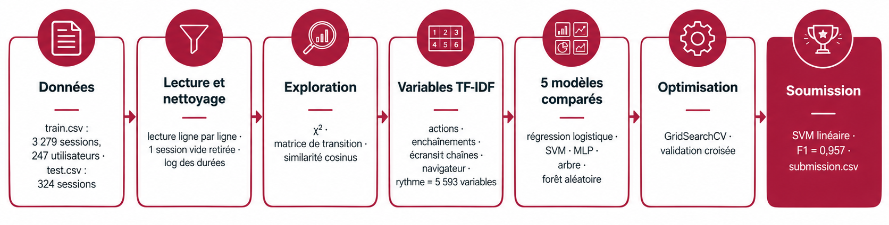

<div align="center">


# Qui utilise mon appli ?
### Identification des utilisateurs du logiciel Copilote à partir de leurs traces d'utilisation

**MOD 7.2 . Introduction à la science des données . BE séances 1, 2, 3**
<br/>
École Centrale de Lyon . Année 2026/2027 . Groupe TD 4

<br/>
<!-- à partir du Shields.io c un service gratuit et c joli -->


</div>

---

## Équipe

- **Hajar Zarguan**
- **Valentine Ponce**
- **Guillaume Sumian**

**Enseignants :** Julien Velcin (CM, BE), Antoine Becquet (BE)

---

## Le problème

La société **Infologic** édite le logiciel **Copilote**, utilisé dans l'agroalimentaire. Ses testeurs internes
utilisent plusieurs profils pour tester le logiciel ; retrouver **qui** se cache derrière une session simplifierait
leur travail et permettrait aussi de **détecter une usurpation de compte**.

Chaque ligne des fichiers est une **session** :

```
sph,Firefox,Exécution d'un bouton(fr.infologic...CopiloteWebSharedController)<DEFAUT>$AC$,t5,Exécution d'un bouton,t10
```

| Élément | Signification |
| --- | --- |
| `sph` | utilisateur (trigramme), uniquement dans `train.csv` |
| `Firefox` | navigateur |
| `Nom(écran)` | action et écran sur lequel elle a lieu |
| `<config>` | configuration d'écran |
| `$chaîne$` | chaîne de la fiche (regroupement logique) |
| `...1` | l'utilisateur est en modification dans la fiche |
| `t5`, `t10`, ... | fenêtres temporelles de 5 secondes |

**Objectif :** prédire l'utilisateur de chacune des 324 sessions de `test.csv` (classification multi-classe,
247 utilisateurs). **Évaluation :** F1 score sur le leaderboard Kaggle du groupe 4.

---

## Organisation du dépôt

```
BE_DataSciences/
├── Data/                     # train.csv, test.csv, sample_submission.csv (non versionnés)
├── assets/                   # logo et schéma de la démarche
├── src/
│   ├── analyse_donnees.py    # point d'entrée : regroupe les 5 fichiers ci-dessous
│   ├── configuration.py      # 1. constantes, style des graphiques, recherche des données
│   ├── preparation.py        # 2. lecture, nettoyage, variables de chaque session
│   ├── visualisation.py      # 3. graphiques de l'exploration et de l'analyse des modèles
│   ├── modeles.py            # 4. préparation des variables, modèles, évaluation
│   └── optimisation.py       # 5. recherche sur grille, modèle final, soumission
├── prepare_data.ipynb        # notebook principal : de la lecture à la soumission, commenté
├── requirements.txt
└── README.md
```

Nous avons réparti le code en un fichier par étape. Le notebook n'a qu'un seul import à faire,
`import analyse_donnees as AN`, qui donne accès à toutes les fonctions :

| Fichier | Étape | Fonctions principales |
| --- | --- | --- |
| `configuration.py` | Configuration | `configurer_graphiques`, `trouver` |
| `preparation.py` | Préparation et nettoyage | `read_ds`, `construire_table_sessions`, `decrire_session`, `controler_qualite`, `nettoyer_sessions`, `retirer_sessions_aberrantes` |
| `visualisation.py` | Visualisation | `browsers_analysis`, `actions_analysis`, `analyser_composants_logiciels`, `tracer_comparaison_modeles`, `tracer_matrice_confusion`, `tracer_importance_variables` |
| `modeles.py` | Modèles | `construire_preparation`, `creer_modeles`, `creer_pipeline`, `decouper_apprentissage_validation`, `comparer_modeles`, `validation_croisee` |
| `optimisation.py` | Optimisation et soumission | `optimiser_tous_les_modeles`, `optimiser_modele`, `entrainer_modele_final`, `ecrire_soumission` |

---

## Démarche

<div align="center">

</div>

### 1. Préparation et nettoyage
- Nous avons d'abord constaté que les lignes vont de 14 à **14 470 champs** : un `read_csv` classique ne suffisait
  pas, nous avons donc lu les **3 279 sessions** du train (247 utilisateurs) et les **324** du test **ligne par ligne**.
- Nous avons découpé chaque jeton en type d'action, écran, configuration, chaîne et indicateur de modification,
  puis calculé quelques indicateurs par session (nombre d'actions, durée, cadence, entropie, nombre d'écrans).
- Nous avons vérifié la qualité des données : aucune ligne vide, aucun doublon, aucune trace partagée entre deux
  utilisateurs. Nous avons retiré **1 session sans action** et gardé les **9 jetons** hors format, négligeables
  sur 2,27 millions.
- Nous avons vu que les durées étaient très asymétriques (jusqu'à 11 790 s). Comme ce sont de vraies sessions, nous
  ne les avons pas supprimées : nous les avons passées au **logarithme**, ce qui donne une distribution presque en cloche.

### 2. Exploration : ce qui distingue les utilisateurs
| Ce que nous avons constaté | Chiffres clés |
| --- | --- |
| Les classes sont déséquilibrées | 4 à 75 sessions par utilisateur, médiane 12 |
| Chaque utilisateur garde un seul navigateur | Firefox 44,7 %, Chrome 40,8 %, Edge 13,8 %, Opera 0,7 % (1 seul utilisateur) |
| Les actions courantes sont communes à tous | « Exécution d'un bouton » = 22,5 % des 2,27 M d'actions, utilisée par les 247 |
| Les actions rares sont discriminantes (χ²) | formulaires, flags, tableaux de bord, raccourcis : χ² ≈ 230 à 320 ; 14 types retenus |
| Les écrans et les chaînes le sont encore plus | 76 chaînes, 219 configurations ; χ² jusqu'à ≈ 1 300 (chaînes MOBI, TRACE…) ; 39 composants retenus |
| Les profils sont distincts | similarité cosinus médiane 0,25 ; quelques collègues très proches (ptb / txk / sdx ≈ 0,9) |

### 3. Pourquoi nous avons choisi le TF-IDF
En regardant les traces, nous avons constaté qu'une session ressemble beaucoup à un **texte** : c'est une suite de
« mots » (les actions, les écrans, les chaînes) dont certains reviennent dans toutes les sessions et d'autres sont
propres à quelques personnes. Notre problème devenait donc proche d'un problème de **traitement de texte** :
reconnaître l'auteur d'un document à partir des mots qu'il utilise.

Nous nous sommes donc servis de la méthode vue en cours pour les textes, le **TF-IDF**, et nous avons essayé de
l'appliquer à nos traces :
- le **TF** (fréquence du terme) donne du poids à une action que l'utilisateur fait souvent dans la session ;
- l'**IDF** (fréquence inverse dans les documents) diminue le poids des actions que tout le monde fait, comme
  « Exécution d'un bouton », et augmente celui des actions rares, qui caractérisent une personne.

C'est exactement ce que l'exploration nous avait montré : les actions les plus fréquentes sont les moins utiles,
les actions et les écrans rares sont les plus discriminants. Nous avons aussi utilisé deux réglages adaptés à nos
données : la pondération **sous-linéaire** (1 + log tf), pour qu'une action répétée des centaines de fois ne domine
pas, et la **normalisation** de chaque vecteur, pour qu'une session courte et une session longue d'un même
utilisateur restent comparables. Enfin, comme pour les textes, nous avons pris en compte l'ordre des actions avec
des **n-grammes** (suites de 2 ou 3 actions consécutives).

### 4. Variables (5 593 par session)
| Groupe | Construction | Nombre |
| --- | --- | :---: |
| `actions` | TF-IDF des jetons complets (type + écran + configuration + chaîne) | 4 111 |
| `enchainements` | TF-IDF des types d'action et des suites d'actions consécutives (n-grammes) | 939 |
| `composants` | TF-IDF des écrans, configurations et chaînes | 532 |
| `statistiques` | log(nb actions), log(durée), cadence, nb de types, part d'actions distinctes, entropie, nb d'écrans | 7 |
| `navigateur` | one-hot | 4 |

Nous avons mis toute la préparation dans un `Pipeline` scikit-learn : le TF-IDF et le `StandardScaler` sont appris
**uniquement** sur les données d'apprentissage, jamais sur la validation ni sur le test.

### 5. Évaluation
Nous avons découpé le train de façon **stratifiée** : 75 % pour apprendre et 25 % pour valider (2 458 / 820 sessions),
puis nous avons vérifié le meilleur modèle en **validation croisée** stratifiée. Nous n'avons utilisé `test.csv`
qu'à la toute fin, pour la soumission.

### 6. Modèles comparés et optimisation
Nous avons comparé cinq méthodes vues en cours, la **régression logistique**, le **SVM linéaire**, le
**perceptron multicouche (MLP)**, l'**arbre de décision** et la **forêt aléatoire**, à une référence qui prédit
toujours l'utilisateur le plus fréquent. Nous les avons ensuite optimisées avec `GridSearchCV`, en validation croisée
à 3 plis sur la seule partie apprentissage : régularisation `C`, pondération des classes, taille du MLP, profondeur
des arbres et nombre d'arbres. Enfin, nous avons réglé la préparation (`min_df`, longueur des n-grammes) sur le
meilleur modèle.

---

## Résultats

### Comparaison des modèles (partie validation, 820 sessions)

| Modèle | F1 micro initial | F1 macro initial | F1 micro optimisé | Meilleurs paramètres |
| --- | :---: | :---: | :---: | --- |
| **SVM linéaire** | **0,957** | **0,951** | **0,957** | `C = 1` |
| Perceptron multicouche | 0,930 | 0,922 | 0,938 | 512 neurones, `alpha = 0,01` |
| Forêt aléatoire | 0,926 | 0,899 | 0,934 | `max_features = "sqrt"` |
| Régression logistique | 0,920 | 0,905 | 0,917 | `C = 100` |
| Arbre de décision | 0,759 | 0,700 | 0,780 | `class_weight = "balanced"` |
| Référence (classe majoritaire) | 0,023 | 0,000 | — | — |

- Le **SVM linéaire** est notre meilleur modèle, et le plus rapide (6 s). Son F1 macro est presque égal au micro :
  il reconnaît aussi bien les petits utilisateurs que les gros.
- En **validation croisée à 5 plis** sur tout le train, il obtient **F1 = 0,970 ± 0,003** : le score est très stable.
- Tous les modèles atteignent 1,000 sur l'apprentissage ; nous avons vu que l'**arbre de décision** sur-apprend
  fortement (écart de 0,24 avec la validation), ce que la forêt aléatoire corrige en grande partie.
- L'optimisation nous a apporté peu (au plus +0,02) : la représentation des sessions compte plus que les paramètres.

### Modèle final
Nous avons retenu le **SVM linéaire**, `C = 1`, avec tous les jetons (`min_df = 1`) et des enchaînements de 1 à
3 actions : F1 = 0,948 ± 0,006 en validation croisée et **0,956** en validation. Nous l'avons ensuite réentraîné sur
tout le train.

### Analyse
- **Variables les plus utiles** (forêt aléatoire) : le navigateur, la configuration `INSTALLATEUR`, l'entropie de
  la session, la paire « Saisie → Bouton », les actions « Raccourci », « Chainage », « Double-clic » et la cadence.
- **Erreurs** : sur les 15 utilisateurs les plus présents, nous n'avons que 6 erreurs sur 151 sessions, surtout vers
  **skm**, l'utilisateur le plus fréquent. Tous les utilisateurs avec plus de 20 sessions d'apprentissage ont un
  F1 > 0,85 ; les 4 utilisateurs jamais reconnus n'ont que 3 à 7 sessions.

### Soumission
- 324 prédictions, **223 utilisateurs différents** prédits, navigateur compatible avec l'utilisateur prédit dans
  **100 %** des cas.
- **Score Kaggle (leaderboard public) :** _à compléter_

---

## Conclusion

Nous avons montré que la façon dont chacun utilise Copilote est une véritable **signature** : son navigateur, les
parties du logiciel qu'il ouvre, les actions rares qu'il est le seul à utiliser et l'ordre dans lequel il les
enchaîne suffisent à retrouver l'utilisateur de **95 à 97 % des sessions**. En traitant les traces comme des textes
avec le TF-IDF, un modèle linéaire simple, le SVM, a suffi. Les erreurs restantes touchent les utilisateurs qui ont
très peu de sessions ou qui travaillent comme un collègue. Pour aller vers la **détection d'intrusion**, nous
proposons d'utiliser la distance d'une session à la frontière du SVM comme score de confiance, afin de signaler une
session qui ne ressemble à aucun profil connu.

---

## Bibliographie

Voici les pages que nous avons consultées:

### 1. Préparation et nettoyage des données
- [pandas read csv rows with variable number of columns](https://stackoverflow.com/questions/31053022/pandas-read-csv-rows-with-variable-number-of-columns) (Stack Overflow) : lire un fichier dont les lignes n'ont pas le même nombre de colonnes.
- [Handling variable number of columns with pandas - Python](https://stackoverflow.com/questions/15242746/handling-variable-number-of-columns-with-pandas-python) (Stack Overflow) : même problème, avec la solution des noms de colonnes fixés à l'avance.
- [Python RegEx](https://www.geeksforgeeks.org/python/python-regex/) (GeeksforGeeks) : expressions régulières pour découper les jetons.
- [re.MatchObject.group() function in Python Regex](https://www.geeksforgeeks.org/python/re-matchobject-group-function-in-python-regex/) (GeeksforGeeks) : récupérer les groupes (écran, configuration, chaîne) d'une action.
- [Interquartile Range to Detect Outliers in Data](https://www.geeksforgeeks.org/interquartile-range-to-detect-outliers-in-data/) (GeeksforGeeks) : règle de l'IQR pour repérer les valeurs aberrantes.
- [Detect and Remove the Outliers using Python](https://www.geeksforgeeks.org/data-science/detect-and-remove-the-outliers-using-python/) (GeeksforGeeks) : retirer les sessions aberrantes.
- [Log Transformation](https://www.geeksforgeeks.org/data-science/log-transformation/) (GeeksforGeeks) : passage au logarithme des durées et du nombre d'actions.

### 2. Exploration et visualisation
- [Chi-Square Test for Feature Selection – Mathematical Explanation](https://www.geeksforgeeks.org/chi-square-test-for-feature-selection-mathematical-explanation/) (GeeksforGeeks) : test du χ² entre les actions et l'utilisateur.
- [How to create a seaborn correlation heatmap in Python?](https://www.geeksforgeeks.org/how-to-create-a-seaborn-correlation-heatmap-in-python/) (GeeksforGeeks) : matrices de corrélation et de transition.
- [How to Calculate Cosine Similarity in Python?](https://www.geeksforgeeks.org/how-to-calculate-cosine-similarity-in-python/) (GeeksforGeeks) : similarité entre les profils d'utilisateurs.

### 3. Représentation des sessions (TF-IDF et variables)
- [Understanding TF-IDF (Term Frequency-Inverse Document Frequency)](https://www.geeksforgeeks.org/machine-learning/understanding-tf-idf-term-frequency-inverse-document-frequency/) (GeeksforGeeks) : principe du TF-IDF.
- [N-gram in NLP](https://www.geeksforgeeks.org/nlp/n-gram-in-nlp/) (GeeksforGeeks) : suites d'actions consécutives (n-grammes).
- [One Hot Encoding in Machine Learning](https://www.geeksforgeeks.org/machine-learning/ml-one-hot-encoding/) (GeeksforGeeks) : codage du navigateur.
- [Prediction using ColumnTransformer, OneHotEncoder and Pipeline](https://www.geeksforgeeks.org/prediction-using-columntransformer-onehotencoder-and-pipeline/) (GeeksforGeeks) : regrouper toutes les transformations dans un `Pipeline`.

### 4. Évaluation
- [Parameter "stratify" from method "train_test_split" (scikit Learn)](https://stackoverflow.com/questions/34842405/parameter-stratify-from-method-train-test-split-scikit-learn) (Stack Overflow) : découpage stratifié apprentissage / validation.
- [Stratified K Fold Cross Validation](https://www.geeksforgeeks.org/machine-learning/stratified-k-fold-cross-validation/) (GeeksforGeeks) : validation croisée stratifiée.
- [Macro VS Micro VS Weighted VS Samples F1 Score](https://stackoverflow.com/questions/55740220/macro-vs-micro-vs-weighted-vs-samples-f1-score) (Stack Overflow) : différence entre F1 micro, macro et pondéré.
- [Computing macro f1 score using sklearn](https://stackoverflow.com/questions/43421456/computing-macro-f1-score-using-sklearn) (Stack Overflow) : calcul du F1 macro avec scikit-learn.
- [Understanding the Confusion Matrix in Machine Learning](https://www.geeksforgeeks.org/confusion-matrix-machine-learning/) (GeeksforGeeks) : lecture de la matrice de confusion.

### 5. Modèles de classification
- [Logistic Regression in Machine Learning](https://www.geeksforgeeks.org/machine-learning/understanding-logistic-regression/) (GeeksforGeeks) : régression logistique.
- [Support Vector Machine (SVM) Algorithm](https://www.geeksforgeeks.org/machine-learning/support-vector-machine-algorithm/) (GeeksforGeeks) : SVM et notion de marge.
- [Multi-layer Perceptron a Supervised Neural Network Model using Sklearn](https://www.geeksforgeeks.org/deep-learning/multi-layer-perceptron-a-supervised-neural-network-model-using-sklearn/) (GeeksforGeeks) : perceptron multicouche avec `MLPClassifier`.
- [Overfitting in Decision Tree Models](https://www.geeksforgeeks.org/overfitting-in-decision-tree-models/) (GeeksforGeeks) : sur-apprentissage de l'arbre de décision.
- [Random Forest Classifier using Scikit-learn](https://www.geeksforgeeks.org/random-forest-classifier-using-scikit-learn/) (GeeksforGeeks) : forêt aléatoire.
- [Feature Importance with Random Forests](https://www.geeksforgeeks.org/machine-learning/feature-importance-with-random-forests/) (GeeksforGeeks) : importance des variables.

### 6. Optimisation
- [Hyperparameter Tuning](https://www.geeksforgeeks.org/machine-learning/hyperparameter-tuning/) (GeeksforGeeks) : principe du réglage des hyperparamètres.
- [SVM Hyperparameter Tuning using GridSearchCV](https://www.geeksforgeeks.org/machine-learning/svm-hyperparameter-tuning-using-gridsearchcv-ml/) (GeeksforGeeks) : recherche sur grille avec `GridSearchCV`.
- [Validation Curve](https://www.geeksforgeeks.org/machine-learning/validation-curve/) (GeeksforGeeks) : courbe de validation du paramètre `C`.

---

## Installation et exécution

```bash
git clone https://github.com/valponce/BE_DataSciences.git
cd BE_DataSciences
python -m venv .venv
source .venv\Scripts\activate
pip install -r requirements.txt
```
Le fichier `submission.csv` est créé à la racine : il se dépose sur Kaggle et sur Moodle.

---

<div align="center">

<sub>École Centrale de Lyon . MOD 7.2 Introduction à la science des données . 2026/2027</sub>

</div>
